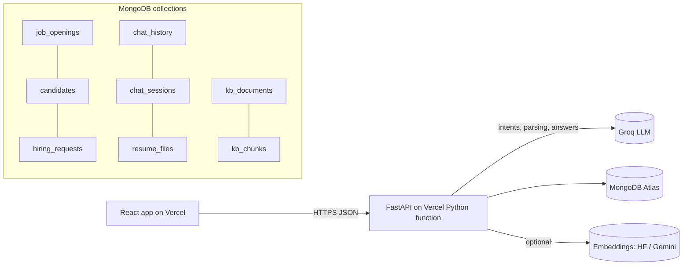

# TalentDesk: AI HR Assistant with RAG

A full-stack HR assistant for internal hiring. Candidates browse roles and apply (a PDF resume autofills the form). Hiring managers raise hiring requests in plain language. HR admins run the pipeline from a dashboard. Questions about HR policy are answered by **retrieval-augmented generation (RAG)** over an HR knowledge base, with numbered citations to the source passages.

| Layer | Technology |
| --- | --- |
| Frontend | React 19, Vite, Tailwind CSS, react-markdown, lucide-react |
| Backend | FastAPI (Python 3.12), Motor (async MongoDB), pypdf |
| LLM | Groq API (model set by `GROQ_MODEL`) |
| Retrieval | Hybrid BM25 + vector search; embeddings from Hugging Face or Gemini (optional), MongoDB Atlas Vector Search (optional) |
| Database | MongoDB (Atlas in production) |
| Deploy | Vercel (two projects: `backend/` as a Python function, `frontend/` as a static Vite app); Docker Compose for local dev |

## Features

- **Candidate:** list and filter openings ("jobs in Noida"); apply through a guided form or autofill from a PDF resume (LLM resume parsing, experience computed from dates); automatic screening against the role (experience, skills, location); status check verified by email and phone; status notifications.
- **Hiring manager:** raise a hiring request in conversation; experience ranges are normalised to `X-Y yrs`.
- **HR admin:** dashboard with clickable stat cards; candidate pipeline (Pending → Shortlisted → Interview Done → Hired / Rejected); approve requests into job openings; delete openings; CSV export by category; AI job-description generator.
- **Knowledge base (new):** upload PDF / TXT / Markdown policies; answers grounded only in retrieved passages, with `[n]` citations shown as expandable source chips; "not in the knowledge base" instead of guessing; a retrieval tester showing chunks and scores; job openings indexed automatically.

## Architecture



The backend is stateless, so it runs on serverless functions:
- multi-step form state lives in `chat_sessions`;
- uploaded resumes are parsed in memory and kept in `resume_files`, with nothing written to disk;
- demo data is seeded lazily on the first request.

## How RAG works here

1. **Ingest** (`POST /kb/upload`, or the bundled sample handbook on first run):
   - Text is extracted in memory with pypdf, or decoded for TXT/MD.
   - It is split into ~800-character chunks with ~120 characters of sentence overlap.
   - Markdown headings are kept as each chunk's section, for citations.
2. **Embed** (optional): chunks are embedded in batches with retries by the provider in `EMBEDDINGS_PROVIDER`:
   - `hf`: Hugging Face Inference API, `all-MiniLM-L6-v2` by default;
   - `gemini`: `gemini-embedding-001`.

   Vectors are stored with their model id. With `none`, or if the provider fails, the system uses BM25 only and keeps working.
3. **Retrieve** (`rag/store.py`): hybrid scoring per chunk, `score = α · cosine + (1 − α) · bm25/(bm25 + 5)`, with α = `RAG_HYBRID_ALPHA`.
   - Cosine is computed with NumPy over stored vectors, or by MongoDB Atlas `$vectorSearch` when `ATLAS_VECTOR_INDEX` is set.
   - Hits below `RAG_MIN_SCORE`, or below `RAG_RELATIVE_CUTOFF` × the best hit, are dropped, and the top `RAG_TOP_K` are kept.
4. **Generate** (`rag/answer.py`): the LLM gets only the numbered passages, must cite every fact as `[n]`, and replies `NOT_FOUND` when the passages don't answer the question. The API returns the answer plus a structured `citations` list (title, section, chunk, score, snippet), which the UI renders as source chips.
5. **Jobs as knowledge:** every opening is indexed as a passage. The index is rebuilt on seed, approve and delete, so "what does the Data Analyst role need?" is answered from the live openings.

No PyTorch, sentence-transformers or FAISS: the backend stays well under Vercel's function size limit.

## Run locally

**Option A: Docker Compose** (MongoDB included)

```bash
cp backend/.env.example backend/.env       # set GROQ_API_KEY
docker compose up --build                  # UI http://localhost:5173 · API http://localhost:8000
```

**Option B: without Docker**

```bash
# backend
cd backend
python -m venv .venv && . .venv/bin/activate      # Windows: .venv\Scripts\activate
pip install -r requirements-dev.txt
cp .env.example .env                              # set GROQ_API_KEY and MONGO_URI
uvicorn main:app --reload --port 8000

# frontend (second terminal)
cd frontend
cp .env.example .env                              # VITE_API_URL=http://localhost:8000
npm install && npm run dev
```

Seed or refresh demo data at any time: `cd backend && python -m scripts.seed` (add `--force` to re-ingest, or `--file policy.pdf` to add a document).

**Tests:** `cd backend && pytest` (in-memory MongoDB, mocked LLM and embeddings, no keys needed). Frontend: `npm run lint && npm run build`.

## Environment variables

Backend (`backend/.env`, or Vercel → Project → Settings → Environment Variables):

| Variable | Required | Default | Purpose |
| --- | --- | --- | --- |
| `GROQ_API_KEY` | yes | – | Groq API key |
| `GROQ_MODEL` | no | `openai/gpt-oss-120b` | Chat model for intents, parsing and answers |
| `MONGO_URI` | yes | `mongodb://localhost:27017` | MongoDB connection string (Atlas `mongodb+srv://…` in production) |
| `MONGO_DB` | no | `hr_chatbot_db` | Database name |
| `ALLOWED_ORIGINS` | yes (prod) | `http://localhost:5173` | Comma-separated frontend origins allowed by CORS |
| `EMBEDDINGS_PROVIDER` | no | `none` | `hf`, `gemini` or `none` (BM25 only) |
| `HF_TOKEN` / `HF_EMBED_MODEL` | if `hf` | – / `sentence-transformers/all-MiniLM-L6-v2` | Hugging Face Inference API |
| `GEMINI_API_KEY` / `GEMINI_EMBED_MODEL` / `GEMINI_EMBED_DIM` | if `gemini` | – / `gemini-embedding-001` / `768` | Google Gemini embeddings |
| `RAG_TOP_K` | no | `4` | Passages given to the LLM |
| `RAG_MIN_SCORE` | no | `0.2` | Minimum hybrid score |
| `RAG_RELATIVE_CUTOFF` | no | `0.5` | Drop hits under this share of the best hit |
| `RAG_HYBRID_ALPHA` | no | `0.6` | Weight of vector vs BM25 score |
| `RAG_CHUNK_CHARS` / `RAG_CHUNK_OVERLAP` | no | `800` / `120` | Chunking |
| `ATLAS_VECTOR_INDEX` | no | – | Atlas Vector Search index name on `kb_chunks` |
| `AUTO_SEED` | no | `true` | Seed demo jobs + sample handbook on first request |
| `MAX_UPLOAD_MB` | no | `5` | Upload size limit |

Frontend (`frontend/.env`, or Vercel env): `VITE_API_URL` is the backend URL, with no trailing slash.

## Deploy on Vercel (frontend and backend)

1. **MongoDB Atlas:** create a free cluster and a database user.
   - In *Network Access*, allow `0.0.0.0/0`, since Vercel functions have no fixed IPs.
   - Copy the `mongodb+srv://…` connection string.
2. **Keys:** create a Groq API key at console.groq.com. Optionally add a Hugging Face token (read access) or a Gemini API key for embeddings.
3. **Push this repository to GitHub.**
4. **Backend project:** in Vercel choose *Add New → Project*, import the repo, and set:
   - *Root Directory* = `backend`;
   - *Framework Preset* = *Other*.

   Add the environment variables: `GROQ_API_KEY`, `MONGO_URI`, `ALLOWED_ORIGINS` (temporarily `*`, or your planned frontend URL), and optionally `EMBEDDINGS_PROVIDER` + key. Deploy. `vercel.json` routes every path to `api/index.py` (FastAPI, Python 3.12, 60 s max duration). Open `https://<backend>.vercel.app/` and you should see `{"status":"HR Chatbot API is running",…}`.
5. **Frontend project:** import the same repo again, and set:
   - *Root Directory* = `frontend`;
   - *Framework Preset* = *Vite*;
   - env `VITE_API_URL=https://<backend>.vercel.app`.

   Deploy.
6. **CORS:** set `ALLOWED_ORIGINS=https://<frontend>.vercel.app` in the backend project and redeploy it.
7. Open the frontend. The first request seeds 42 demo openings and the sample handbook. To seed explicitly, call `POST /admin/bootstrap` with header `X-User-Role: HR Admin`.

### Optional: Atlas Vector Search index

With embeddings on, create an index (Atlas → *Search* → *Create Index* → *JSON editor*) on collection `kb_chunks`, for example named `kb_vectors`, then set `ATLAS_VECTOR_INDEX=kb_vectors`. Set `numDimensions` to 384 for MiniLM, or to your `GEMINI_EMBED_DIM`:

```json
{
  "fields": [
    { "type": "vector", "path": "embedding", "numDimensions": 384, "similarity": "cosine" },
    { "type": "filter", "path": "embed_model" }
  ]
}
```

Without the index, cosine similarity runs in Python, which is fine for HR-sized corpora (hundreds of chunks).

## Demo credentials

Roles are chosen in the sidebar. The email and phone are used to find earlier conversations.

| Role | Email | Phone |
| --- | --- | --- |
| HR Admin | `hradmin@abc.com` | `0000000000` |
| Hiring Manager | `hrm@abc.com` | `1111111111` |
| Candidate | any email | any 10-digit phone |

**Security note:** this is a demo without real authentication. The role is declared by the client, and knowledge-base writes only check the `X-User-Role: HR Admin` header. Put real auth in front of it (for example OAuth or SSO with role claims) before using it with real employee or candidate data.

## API overview

| Method | Path | Purpose |
| --- | --- | --- |
| POST | `/chat` | Conversational endpoint → `{response, citations}` |
| POST | `/login` | Restore a previous session by email + role |
| POST | `/upload` | Resume upload (parsed in memory) → `{file_url}` |
| GET | `/uploads/{id}/{name}` | Download an uploaded resume |
| GET | `/notifications` | Role-specific notifications |
| GET | `/admin/dashboard` | Stats, candidates, requests, jobs |
| PUT | `/admin/candidates/{id}/status` | Move a candidate in the pipeline |
| POST | `/admin/requests/{id}/approve` | Turn a request into an opening |
| DELETE | `/admin/jobs/{id}` | Remove an opening |
| GET | `/export?type=…` | CSV export |
| POST | `/kb/upload` | Add a document (HR Admin) |
| GET | `/kb/documents` | List documents |
| DELETE | `/kb/documents/{id}` | Remove a document (HR Admin) |
| POST | `/kb/search` | Retrieval only: passages + scores |
| POST | `/kb/reindex-jobs` | Rebuild job passages (HR Admin) |
| POST | `/admin/bootstrap` | Seed demo data (HR Admin) |

## Project layout

```
backend/
  api/index.py        Vercel entry point (exports the FastAPI app)
  main.py             HTTP API
  bot_logic.py        conversation flows and intent routing
  rag/                chunking, scoring (BM25, cosine, fusion), embeddings, store, grounded answers
  seed/               demo jobs + fictional sample handbook
  scripts/seed.py     seeding / ingestion CLI
  tests/              pytest suite (no external services)
frontend/
  src/components/     Sidebar, ChatView, Dashboard, KnowledgeBase, AuthDialog, …
  src/lib/            API client, roles
```
